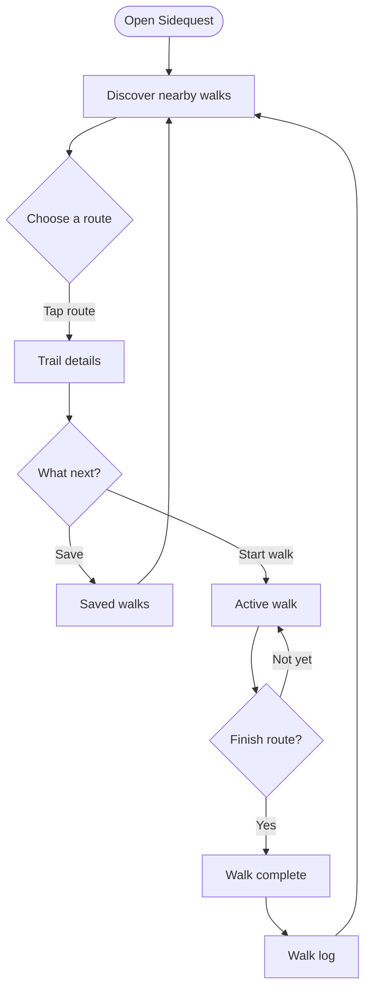

# Sidequest: App Flow

## App idea

Sidequest helps people find a nearby walk that fits the time and energy they have. Users can browse local routes, filter by difficulty or duration, save a route, and walk it.

## Primary user journey

## Screen notes

- **Discover:** Browse route cards; filter by all routes, easy walks, walks under an hour, or saved walks.
- **Trail details:** Review route distance, estimated duration, difficulty, and location before choosing an action.
- **Decision:** Save the route for another day or start the walk now.
- **Active walk:** Keep the selected route and progress available while walking.
- **Walk complete:** Finish the route and add it to the walk log.
- **Saved walks:** Return to saved routes and start one later.

The **App flow** tab in the prototype lets you select each step and move through the journey. The **Discover** tab demonstrates route filtering and saving.
